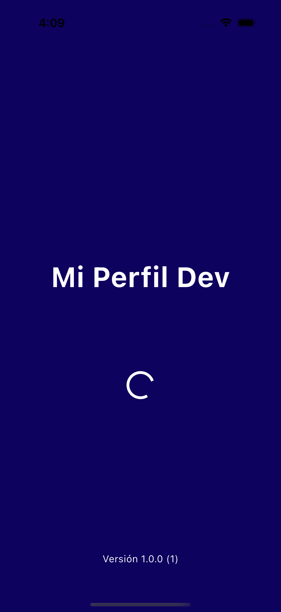
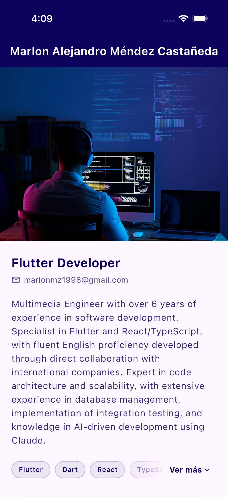
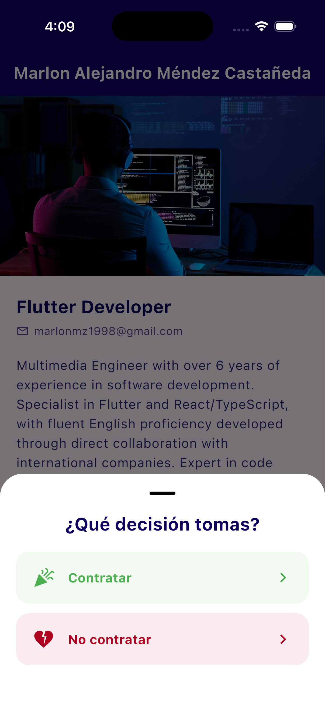
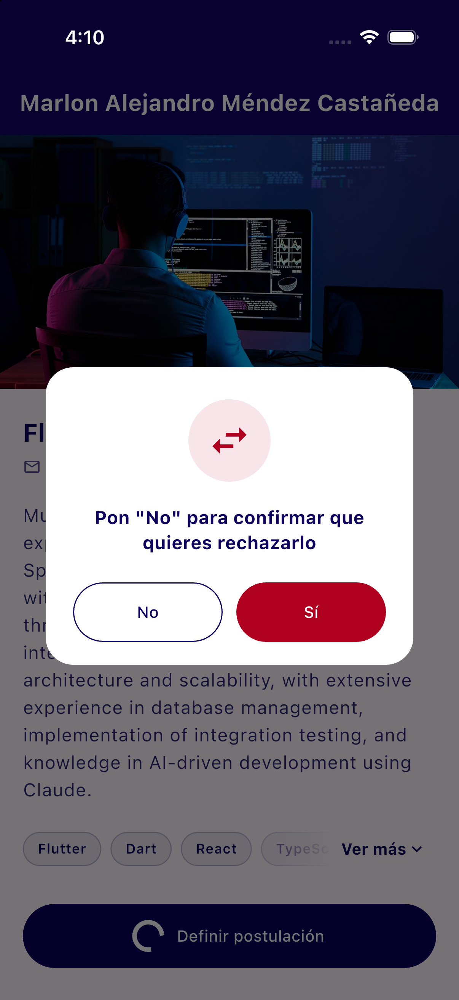
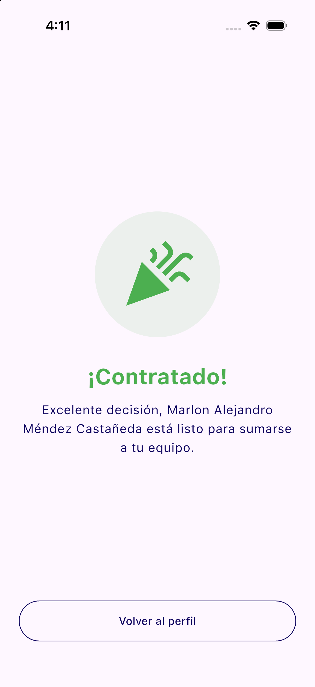
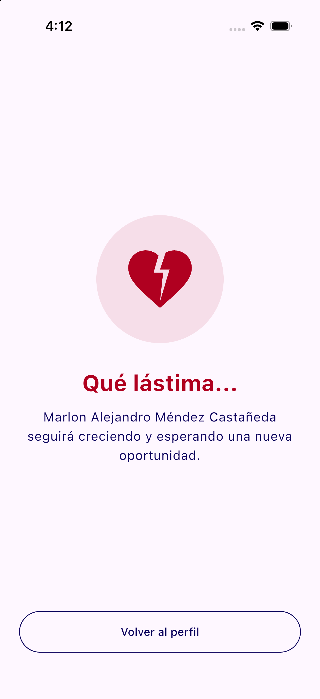
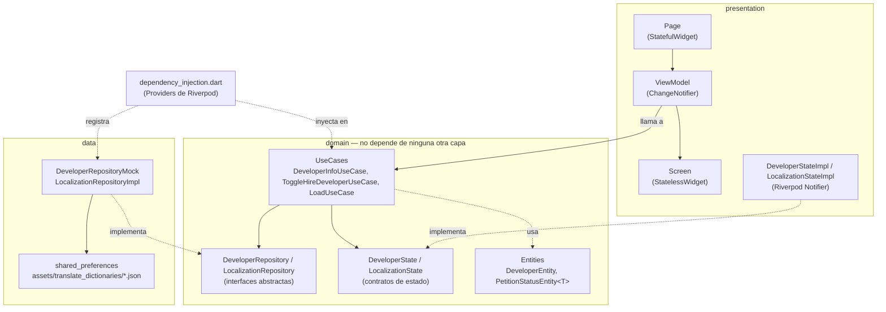

# Mi Perfil Dev

App Flutter que funciona como una **hoja de vida interactiva** de un desarrollador: muestra su perfil (foto, rol, bio, correo y skills) y le permite a quien la revisa **tomar una decisión de contratación** directamente desde la app — contratar o rechazar — y ver una pantalla de resultado según la decisión.

## ¿Qué problema resuelve y para quién?

- **Problema**: un CV en PDF es estático y no demuestra cómo trabaja el desarrollador. Esta app presenta el perfil y, al mismo tiempo, sirve como muestra de código real: arquitectura, manejo de estados, i18n y tests.
- **Para quién**: reclutadores y líderes técnicos que evalúan al candidato. Pueden leer el perfil, revisar el código del repo y registrar su decisión (que queda persistida en el dispositivo).
- **Detalle de UX**: contratar pide una sola confirmación; rechazar pide **cinco** confirmaciones encadenadas (con botones que incluso se intercambian de lugar) — a propósito, para hacer el rechazo "tedioso" de forma divertida.

Proyecto construido con **Clean Architecture** (domain / data / presentation), MVVM en la capa de presentación, **Riverpod** para estado global e inyección de dependencias y **go_router** para la navegación.

## Capturas

| Splash | Perfil del desarrollador | Decisión de contratación |
|:---:|:---:|:---:|
|  |  |  |

| Confirmación al rechazar | Contratado | No contratado |
|:---:|:---:|:---:|
|  |  |  |

## Requisitos previos

| Herramienta | Versión |
|---|---|
| Flutter | `3.47.x` (canal stable; desarrollado con `3.47.5`) |
| Dart SDK | `^3.13.4` (definido en `pubspec.yaml`) |
| Xcode + CocoaPods | Solo para correr en iOS/macOS |
| Android Studio / Android SDK | Solo para correr en Android |

Verificar el entorno con:

```bash
flutter doctor
```

### Plataformas soportadas

- **Android** e **iOS**: plataformas objetivo de la app.
- **Web, macOS, Linux y Windows**: las carpetas de plataforma están generadas, pero no son el foco del proyecto ni se han validado a fondo.

No se necesita ningún API key ni archivo `.env`: hoy el perfil se sirve desde un repositorio mock (`DeveloperRepositoryMock`) y la decisión de contratación se guarda localmente con `shared_preferences`.

## Cómo ejecutarlo

1. Clonar el repositorio:

   ```bash
   git clone https://github.com/marlonc98/pragma_road_0.git
   cd pragma_road_0
   ```

2. Instalar dependencias (como `pubspec.lock` no se versiona, este paso resuelve las versiones según los rangos de `pubspec.yaml`):

   ```bash
   flutter pub get
   ```

3. Ver los dispositivos disponibles y correr la app:

   ```bash
   flutter devices
   flutter run
   ```

   Para un dispositivo específico: `flutter run -d <device_id>` (por ejemplo `-d ios` o el id de un emulador Android).

4. (Opcional) Generar un build:

   ```bash
   flutter build apk --release
   flutter build ios --release
   ```

## Cómo contribuir

El flujo completo (ramas, estilo de commits y checklist de PR) está en [CONTRIBUTING.md](CONTRIBUTING.md). En resumen, antes de abrir un PR:

```bash
dart format lib test
flutter analyze
flutter test
```

## Estructura de carpetas y arquitectura

El código en `lib/` está organizado en tres capas, siguiendo la regla de dependencia de Clean Architecture: `domain` no conoce a `data` ni a `presentation`; las otras dos capas dependen de `domain`, nunca al revés.



```
lib/
├── domain/              # Reglas de negocio puras, sin Flutter ni detalles de almacenamiento
│   ├── entities/         # DeveloperEntity, PetitionStatusEntity<T>
│   ├── repositories/     # Contratos abstractos (DeveloperRepository, LocalizationRepository)
│   ├── use_cases/        # Una operación de negocio por clase (DeveloperInfoUseCase, ToggleHireDeveloperUseCase, LoadUseCase)
│   ├── states/           # Contratos de estado global (DeveloperState, LocalizationState)
│   └── constants/        # Claves de error compartidas (ErrorsConstants)
│
├── data/                # Implementaciones concretas de los contratos de domain
│   └── repositories/
│       ├── developer/     # DeveloperRepositoryMock (perfil fijo + decisión en shared_preferences)
│       └── localization/  # LocalizationRepositoryImpl + api/ (idioma guardado y carga de JSON)
│
├── presentation/        # UI + estado de UI
│   ├── pages/            # Cada pantalla: Page + Screen + ViewModel (+ widgets/ propios)
│   │   ├── splash/                 # Carga traducciones y versión, luego navega al detalle
│   │   ├── developer/detailed/     # Perfil del desarrollador y bottom sheet de decisión
│   │   └── application_result/     # HiredPage / NotHiredPage
│   ├── widgets/          # Widgets reutilizables (loaders, errores, sin resultados, diálogos, imágenes)
│   ├── states/           # Implementación Riverpod de los contratos de domain/states
│   ├── utils/            # ViewModel base + StfViewModelAdapter
│   ├── theme/            # Colores y temas claro/oscuro
│   ├── constants/        # TextConstants (claves de traducción)
│   ├── router.dart       # Rutas con go_router
│   └── app.dart          # MaterialApp.router
│
├── dependency_injection.dart  # Todos los Providers (repositorios, estados y casos de uso)
└── main.dart                  # Punto de entrada, envuelve la app en ProviderScope

assets/translate_dictionaries/  # Traducciones (es.json)
test/                           # Tests de widgets del flujo principal
```

### Capas

- **domain**: define *qué* hace la app. Las entidades, los contratos de repositorio y de estado, y los casos de uso. Un caso de uso como `ToggleHireDeveloperUseCase` pide al repositorio que guarde la decisión y, si tiene éxito, actualiza el `DeveloperState` — sin saber que por debajo hay `shared_preferences` ni Riverpod.
- **data**: define *cómo* se obtienen y guardan los datos. Hoy el perfil es un mock; reemplazarlo por un backend real solo requiere una nueva implementación de `DeveloperRepository` y cambiar un Provider en `dependency_injection.dart`.
- **presentation**: dibuja la UI y reacciona a los cambios de estado. Los `ViewModel` llaman casos de uso a través de los Providers, nunca a los repositorios directamente.

### Inyección de dependencias con Riverpod

[dependency_injection.dart](lib/dependency_injection.dart) declara todos los `Provider`/`NotifierProvider` de la app, agrupados en repositorios, estados y casos de uso. Las capas superiores dependen solo de los tipos abstractos de `domain` (`Provider<DeveloperRepository>`), así que cambiar una implementación (o sobreescribirla en un test con `ProviderScope(overrides: ...)`) no toca el resto del código.

### Patrón de cada pantalla (Page / Screen / ViewModel)

Para mantener los widgets separados de su lógica, cada pantalla se divide en tres archivos con una responsabilidad única:

- **`*_page.dart`**: `StatefulWidget` con su `route` estática; solo crea el `ViewModel` vía `StfViewModelAdapter`.
- **`*_page_view_model.dart`**: extiende `ViewModel<T>` (un `ChangeNotifier` con acceso a `context` y `WidgetRef`), llama a los casos de uso y expone el estado a la UI.
- **`*_page_screen.dart`**: widget que recibe el `ViewModel` y solo dibuja UI — no conoce casos de uso ni repositorios.

[StfViewModelAdapter](lib/presentation/utils/stf_view_model_adapter.dart) es el pegamento: un `ConsumerStatefulWidget` que crea el `ViewModel` una sola vez, lo reconstruye con `ListenableBuilder` y lo libera en `dispose`.

### Manejo de resultados asíncronos: `PetitionStatusEntity<T>`

En vez de exponer `Future<T>` crudo, los repositorios devuelven [PetitionStatusEntity<T>](lib/domain/entities/petition_status_entity.dart): un wrapper con `status` (`notStarted` / `loading` / `complete` / `failed`), `data` y `error`. Así la UI representa los cuatro estados de una petición de forma explícita.

[LoaderScreenWidget<T>](lib/presentation/widgets/loader_screen_widget.dart) traduce ese estado en UI (loading / error con reintentar / sin resultados / contenido). Su `builder` recibe el dato **ya desenvuelto y no nulo**, así las pantallas nunca hacen `data!`. Los errores se muestran traducidos a partir de las claves de [ErrorsConstants](lib/domain/constants/errors_constants.dart), nunca como texto crudo de una excepción.

### Internacionalización

> **Hoy la app está solo en español (`es`).** No hay selector de idioma en la UI.

Los textos visibles no se escriben directo en los widgets. Se usan claves definidas en [TextConstants](lib/presentation/constants/text_constants.dart), y las traducciones viven en `assets/translate_dictionaries/<locale>.json` (hoy solo existe `es.json`). `LocalizationState.translate(key, values: {...})` busca la clave y reemplaza variables con la sintaxis `{variable}`, por ejemplo `"Versión {version} ({build})"`. Si una clave no existe en el JSON, se muestra la clave tal cual, así un texto faltante se detecta rápido.

#### Cómo agregar otro idioma

1. **Crear el diccionario**: copiar `assets/translate_dictionaries/es.json` como `<codigo>.json` (por ejemplo `en.json`) y traducir **todos** los valores sin cambiar las claves. No hay que tocar `pubspec.yaml`, porque ya registra la carpeta completa (`assets/translate_dictionaries/`).
2. **Registrarlo como idioma disponible**: agregar el código a la lista de opciones en [get_language_api_impl.dart](lib/data/repositories/localization/api/get_language_api_impl.dart):

   ```dart
   List<String> _options = ["es", "en"];
   ```

   El primero de la lista es el idioma por defecto cuando el usuario no ha elegido ninguno.
3. **Conectar la selección** (pendiente, porque con un solo idioma no hacía falta):
   - En [localization_state_impl.dart](lib/presentation/states/localization_state_impl.dart), el idioma inicial está fijo en `'es'`. Debe leerse con `LocalizationRepository.getLanguage()`, que ya devuelve el idioma guardado en `shared_preferences` o el idioma por defecto.
   - Agregar en el repositorio un método para guardar la elección bajo la clave `LocalizationRepositoryImpl.localizationRepositoryKey`, más un selector en la UI que lo llame y asigne `locale` en el estado. El setter de `locale` ya recarga las traducciones y redibuja los widgets que escuchan `localizationStateProvider`.

Al agregar un texto nuevo, la clave debe ir en `TextConstants` y en **cada** JSON de idioma.

## Paquetes principales

| Paquete | Para qué se usa | Por qué está |
|---|---|---|
| `flutter_riverpod` / `riverpod` | Estado global e inyección de dependencias | Es el mecanismo central de la arquitectura: declara repositorios, estados y casos de uso como Providers (ver [Inyección de dependencias con Riverpod](#inyección-de-dependencias-con-riverpod)). |
| `go_router` | Navegación entre splash, detalle y pantallas de resultado | Se incluyó **con fines de aprendizaje**. Con solo cuatro rutas, el `Navigator` nativo de Flutter alcanzaría. La idea era practicar rutas declarativas (`context.go` / `context.push`), que escalan mejor si después se agregan deep links o rutas anidadas. |
| `shared_preferences` | Persistencia local de clave-valor | Se agregó pensando en **soportar varios idiomas**: `get_language_api_impl.dart` ya lee de aquí el idioma guardado, así que cuando exista un selector de idioma solo faltará escribir la elección del usuario. Mientras tanto, el repositorio mock también lo usa para guardar la decisión de contratar/rechazar, de modo que se conserve al reiniciar la app. |
| `package_info_plus` | Leer la versión y el número de build de la app | Se muestran en el splash (`Versión {version} ({build})`) para saber qué build se está revisando sin tener que abrir `pubspec.yaml`. |
| `flutter_test`, `flutter_lints` (dev) | Tests y reglas de análisis estático | Ver [CONTRIBUTING.md](CONTRIBUTING.md). |

## Archivos que no se versionan

El [.gitignore](.gitignore) excluye todo lo que es local a la máquina o sensible:

- **Generados / locales**: `build/`, `.dart_tool/`, `.idea/`, `*.iml`, `.metadata`, `pubspec.lock`, `Podfile.lock`, `Pods/`, `xcuserdata/`, `local.properties`, `.vscode/settings.json`.
- **Credenciales**: `.env` / `.env.*` (se permite `.env.example`), `key.properties`, keystores (`*.jks`, `*.keystore`), certificados y perfiles de iOS (`*.p12`, `*.p8`, `*.mobileprovision`), `google-services.json` y `GoogleService-Info.plist`.

Si en el futuro se agrega un secreto (por ejemplo un API key), debe ir en `.env` y documentarse con un `.env.example` sin valores reales.

## Limitaciones conocidas / próximos pasos

- El perfil del desarrollador está quemado en `DeveloperRepositoryMock`; el siguiente paso natural es una implementación conectada a un backend.
- La app está solo en español (`es`). Para agregar idiomas falta conectar el idioma guardado al estado y crear un selector; ver [Cómo agregar otro idioma](#cómo-agregar-otro-idioma).
- Los tests actuales son de widgets sobre el flujo principal; faltan tests unitarios de casos de uso y de `PetitionStatusEntity`.

## Créditos de imágenes

La imagen de portada del perfil ([assets/images/profile.jpg](assets/images/profile.jpg)) es una **foto de stock descargada de [Pixabay](https://pixabay.com/)**. **No es una foto del desarrollador**: se usa solo como imagen ilustrativa en el encabezado del perfil (`DeveloperRepositoryMock.profileImageUrl`).

- Se distribuye bajo la [Licencia de contenido de Pixabay](https://pixabay.com/service/license-summary/), que permite usarla gratis en proyectos (también comerciales) sin atribución obligatoria. Igual se acredita aquí por transparencia.
- Se guarda como asset local, en vez de usar una URL externa, para que no dependa de internet ni venza. La foto de LinkedIn que se usaba antes tenía una URL firmada con fecha de vencimiento y dejó de cargar.
- Para cambiarla, basta con reemplazar el archivo manteniendo el nombre, o apuntar `profileImageUrl` a otra ruta `assets/...` o a una URL `https://...`. La pantalla de detalle la pinta con `ImageNetworkWithLoadWidget`, que soporta ambos casos.

## Licencia

El código se distribuye bajo la licencia [MIT](LICENSE).

Quedan fuera de la licencia MIT:

- **Los datos personales del perfil** en `DeveloperRepositoryMock` (nombre, correo, rol y bio). Son datos propios del autor y **no pueden ser usados por terceros**.
- **La imagen de portada**, que se rige por la Licencia de contenido de Pixabay (ver [Créditos de imágenes](#créditos-de-imágenes)).
